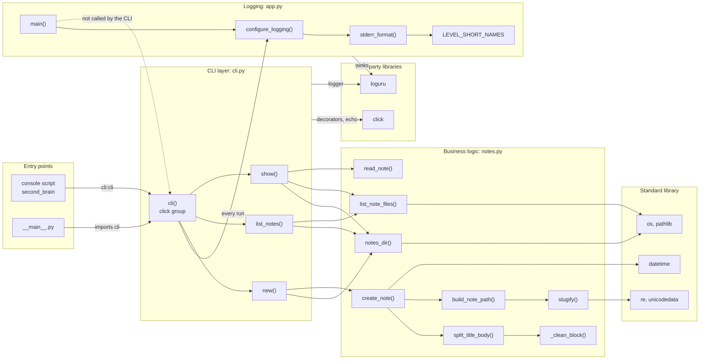
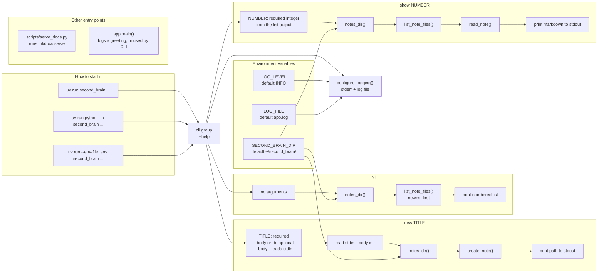
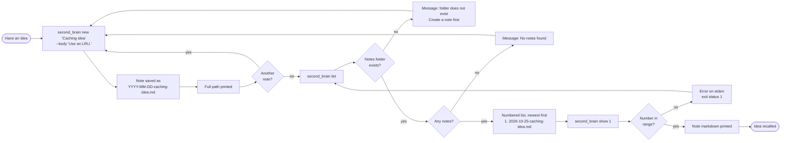

# Diagrams

Three views of the `second_brain` package: how the code is wired together,
how the program is started, and what a user typically does with it.

## 1. Package overview

Every source file, its functions, and what imports what. Solid arrows are
imports or calls that happen at runtime; the dashed arrow marks code that
exists but is not connected to the CLI.

## 2. Entry points and arguments

The ways to start the program, the command and arguments each one accepts, and
what runs behind them.

## 3. Example user flow

A typical session: capture a note, find it again, and read it. Error
branches show what happens when something is missing.

